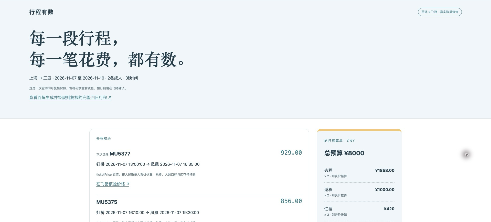

# 行程有数 · 预算旅行助手

输入日期、人数与预算，用飞猪真实产品数据核对机酒，再让百炼生成留有休息时间的行程。每一个金额都保留单位；缺失价格不会变成零元。

[打开演示快照](https://liangzai4322.github.io/fliggy-ai-travel-2026/) · [完整四日行程](demo/demo-report.md) · [实测与复核记录](docs/VERIFICATION.md)



演示展示 2026-10-22 的实际查询结果；页面不连接凭据、不提供实时聊天。完整 AI 体验通过百炼复现。

## 作品结构

- **运行时智能体**：阿里云百炼 Managed Agent，Qwen3.8-Flash，挂载官方飞猪旅行 Skill。百炼负责需求理解、调用工具、比较候选、规划与解释。Multi-Agent 关闭。
- **复现脚本**：`travel.py` 使用官方 CLI 执行三项查询、保存带时间的响应，确定性核算列表价与估算，并生成可离线浏览的 HTML 预算报告。这个脚本自身不调用百炼；完整 AI 体验通过下面的百炼路径复现。
- **可复核交付**：三项原始查询证据、查询条件、价格单位、预算单和实际运行截图。历史快照不能保证当前库存和价格。

## 在百炼中复现完整 AI 体验

1. 在阿里云百炼的 Managed Agent 创建智能体，按 `agent/config.json` 配置，系统提示词使用 `agent/system-prompt.md`。该 JSON 是人工配置清单，非官方导入格式。
2. 添加官方“飞猪旅行 V1.0”技能，来源为 [alibaba-flyai/flyai-skill](https://github.com/alibaba-flyai/flyai-skill)。新运行时通过 `npm i -g @fly-ai/flyai-cli` 安装 CLI。不同会话可能使用独立运行时，需要重新检查安装。
3. 从 [FlyAI 官方控制台](https://flyai.open.fliggy.com/console)获取自己的 Key。在**创建会话**时，将 `FLYAI_API_KEY` 作为环境变量注入，不写进提示词。
4. 输入以下示例（未来复现时请调整日期）：

> 2名成人，2026年11月7日上海出发到三亚，11月10日返程，3晚1间，总预算8000元。直飞优先，海边散步，行程轻松。查询真实往返机票和酒店，保留查询时间和官方链接，区分税费、酒店起价及餐饮等估算；缺信息时不要宣称预算可行。给首选与备选、预算算式、4天3晚行程。只查询，不下单。

5. 审阅并允许只读查询工具。核对工具响应与报告的一致性。正式调用需自备有效额度，平台费用按账号实际规则执行。

## 运行可复现的预算报告

依赖 Python 3.10+、Node.js 和官方 FlyAI CLI。Python 脚本只使用标准库。

```sh
npm i -g @fly-ai/flyai-cli@1.0.16
# 在运行环境的安全配置中注入 FLYAI_API_KEY，不在聊天/源码中粘贴凭据。
python3 travel.py --request examples/sanya.json --output output
# 用浏览器打开 output/report.html。
```

修改 `examples/sanya.json` 调整城市、日期、成人数、房间数、预算和估算费用。实时查询拒绝过去日期。运行前应阅读官方 Skill 对应的 `references/search-flight.md`、`references/search-hotel.md`，确认当前参数契约。

三项查询：

```sh
flyai search-flight --origin 上海 --destination 三亚 --dep-date 2026-11-07 --journey-type 1 --sort-type 3
flyai search-flight --origin 三亚 --destination 上海 --dep-date 2026-11-10 --journey-type 1 --sort-type 3
flyai search-hotel --dest-name 三亚 --check-in-date 2026-11-07 --check-out-date 2026-11-10 --hotel-stars 4,5 --sort price_asc --max-price 900
```

复读本脚本生成的历史证据，不请求网络：

```sh
python3 travel.py --request examples/sanya.json --replay demo --output replay
```

每个证据 JSON 包含命令数组、UTC 时间、退出码、完整成功响应。原始 stderr 不落盘，以避免 SDK 错误携带认证字段；失败时保存通用错误状态。输出文件不包含凭据。脚本不自动重试、不创建订单。

`demo/evidence/` 保留百炼运行时导出的原始证据。`demo/outbound.json`、`return.json`、`hotel.json` 仅增加脚本需要的 `time`、`argv` 别名和来源路径，响应内容不变。样例的 `selection` 来自百炼方案 A；省略时选择可解析的最低列表价，指定候选不存在时保留价格缺口。

## 预算口径

`(去程成人列表价 + 返程成人列表价) × 成人数 + 酒店列表起价 × 晚数 × 房间数 + 估算费用`

该算式提供**参考数**。航空税费、行李、多人同价库存、酒店指定房型与入住人数、三晚成交总价均须在实际产品页核验。在这些信息完整前，即使参考数低于预算也不宣称“预算已满足”。缺任一项列表价，完整参考合计显示“待补齐”。

## 验证

```sh
python3 -m unittest discover -s tests -v
```

6 项测试覆盖人数与晚数乘算、金额精度、未知价格、业务失败、证据与需求不匹配及实际 `ticketPrice` 字段。测试里的模拟价格只用于边界验证，不作为实际效果证据。

## 实测记录

2026-10-22：在百炼内使用正式环境凭据，往返机票和酒店三项查询均成功，各返回 10 条。实际航班价格字段为 `ticketPrice`，已适配并保留价格口径缺口。方案 A 的列表价推算与估算合计 ¥5978，最终税费、人数库存及酒店完整报价仍待核验。详见 [验证记录](docs/VERIFICATION.md)。


## 凭据与发布

仅发布源码、无凭据的证据与经检查的截图。不发布 `.env`、运行时配置、环境变量界面、账号标识或原始会话导出。公开报名 Issue 只需一个主要提交人 GitHub ID，不填写手机号或收货地址。
