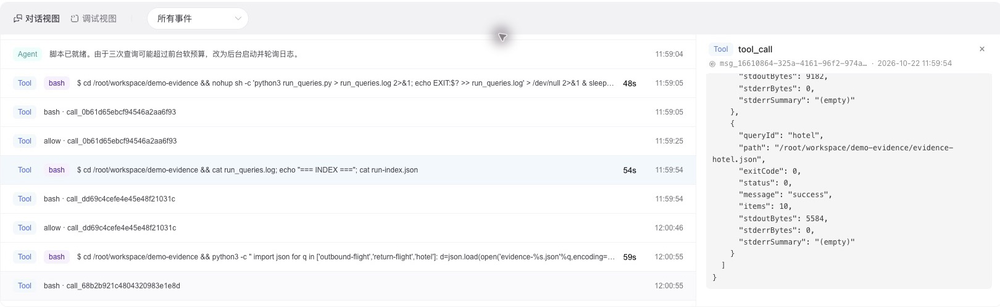
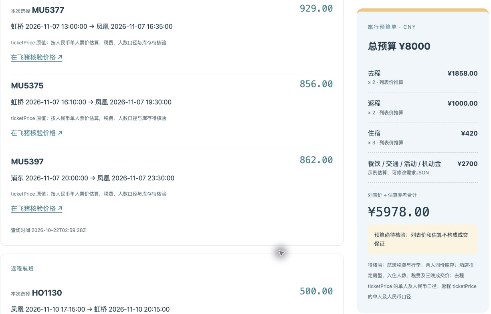

# 实测与复核记录

日期：2026-10-22。以下为真实运行记录，不是测试夹具。

## 百炼运行

阿里云百炼 Managed Agent，模型 Qwen3.8-Flash，官方“飞猪旅行 V1.0”Skill，Multi-Agent 关闭。运行时安装 `@fly-ai/flyai-cli@1.0.16`；正式凭据通过会话环境变量注入。

| 查询 | UTC 开始时间 | CLI 退出码 | 业务状态 | 返回条数 |
|---|---|---:|---:|---:|
| 上海→三亚，2026-11-07，直达 | 2026-10-22T02:59:28Z | 0 | 0 / success | 10 |
| 三亚→上海，2026-11-10，直达 | 2026-10-22T02:59:29Z | 0 | 0 / success | 10 |
| 三亚，11-07 至 11-10，档次筛选 4,5，每晚最高 900 | 2026-10-22T02:59:30Z | 0 | 0 / success | 10 |

三份原始完整响应在 [`demo/evidence/`](../demo/evidence/)，其中保留无密钥命令数组、CLI 版本、起止时间及退出码。本次三个 stderr 均为 0 字节。此前免 Key 模式曾返回 `429 Trial limit reached`，正式验证通过有效凭据完成。



## 报告复核

- 实际航班字段为 `ticketPrice`；官方示例中的 `adultPrice` 本次未返回。脚本同时支持两者，并对 `ticketPrice` 的单人及人民币口径保留待核验说明。
- 酒店 `price` 为列表起价，指定房型、人数、完整三晚价格和税费未返回。
- 百炼方案 A：MU5377、HO1130、摩卡时光海景度假公寓。按单人及每间每晚口径推算：`(929 + 500) × 2 + 140 × 3 = 3278`。
- 餐饮 1200、市内交通 400、活动 300、机动金 800 均为估算；参考合计 `3278 + 2700 = 5978`。参考数小于 8000，最终预算是否满足仍为未知。
- `demo-report.md` 和 `demo-summary.json` 为百炼输出后经字段和预算规则复核的发布版。修正了未经证实的“已核验小计”、预算保证、酒店服务和日落描述；原始接口证据未修改。
- Chrome 已打开生成页面，核对候选、时间、官方跳转链接和参考合计均与证据一致。截图仅裁掉浏览器工具栏或无关账号区域，未改动查询结果。



## 可重复验证

```sh
python3 -m unittest discover -s tests -v
python3 travel.py --request examples/sanya.json --replay demo --output replay
```

6 项边界测试通过：金额精度、人数与晚数乘算、价格缺失、业务失败、需求不匹配及实际 `ticketPrice` 字段。历史证据复读成功，参考合计为 5978.00；复读不请求网络。

发布范围仅包含源码、需求样例、无凭据证据及已检查的截图。运行截图和源码不包含 Key 值；不发布环境变量界面与原始会话导出。
